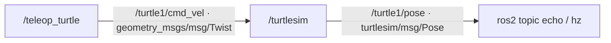

# ПР01. Наблюдения графа ROS 2

Опыт фактически выполнен в одном Docker-контейнере, ROS 2 Jazzy.
Три терминала подключают `source /opt/ros/jazzy/setup.bash`.
Во всех стадиях симулятор работает в домене 16 без перезапуска.
Управление останавливается через Ctrl+C и запускается заново в доменах
16 → 17 → 16. Нажатия стрелки вверх переданы в настоящий PTY teleop.

## Исправный граф

Терминал A, домен 16: `ros2 run turtlesim turtlesim_node`.
Терминал B, домен 16: `ros2 run turtlesim turtle_teleop_key`.
На хосте обнаружено окно `TurtleSim` класса `turtlesim_node` (500×500).



`/teleop_turtle` читает клавиатуру и публикует команды скорости.
`/turtlesim` принимает их, обновляет положение черепахи и публикует позу.
CLI-наблюдатели запускаются временно, отдельной собственной ноды в ПР01 нет.

Терминал C: `ros2 node list --no-daemon --spin-time 2`:

```text
/teleop_turtle
/turtlesim
```

`ros2 topic list -t`:

```text
/parameter_events [rcl_interfaces/msg/ParameterEvent]
/rosout [rcl_interfaces/msg/Log]
/turtle1/cmd_vel [geometry_msgs/msg/Twist]
/turtle1/color_sensor [turtlesim/msg/Color]
/turtle1/pose [turtlesim/msg/Pose]
```

| Полное имя топика | Тип | Назначение |
| --- | --- | --- |
| /turtle1/cmd_vel | geometry_msgs/msg/Twist | Команда линейной и угловой скорости из teleop в симулятор |
| /turtle1/pose | turtlesim/msg/Pose | Положение, ориентация и скорости черепахи |
| /turtle1/color_sensor | turtlesim/msg/Color | Цвет фона под черепахой |
| /parameter_events | rcl_interfaces/msg/ParameterEvent | События изменения параметров нод |
| /rosout | rcl_interfaces/msg/Log | Сообщения журнала ROS |

`ros2 node info /turtlesim` (полный исходный вывод в `turtlesim-info.txt`):

```text
/turtlesim
  Subscribers:
    /parameter_events: rcl_interfaces/msg/ParameterEvent
    /turtle1/cmd_vel: geometry_msgs/msg/Twist
  Publishers:
    /parameter_events: rcl_interfaces/msg/ParameterEvent
    /rosout: rcl_interfaces/msg/Log
    /turtle1/color_sensor: turtlesim/msg/Color
    /turtle1/pose: turtlesim/msg/Pose
  Service Servers:
    /clear: std_srvs/srv/Empty
    /kill: turtlesim/srv/Kill
    /reset: std_srvs/srv/Empty
    /spawn: turtlesim/srv/Spawn
    /turtle1/set_pen: turtlesim/srv/SetPen
    /turtle1/teleport_absolute: turtlesim/srv/TeleportAbsolute
    /turtle1/teleport_relative: turtlesim/srv/TeleportRelative
    /turtlesim/describe_parameters: rcl_interfaces/srv/DescribeParameters
    /turtlesim/get_parameter_types: rcl_interfaces/srv/GetParameterTypes
    /turtlesim/get_parameters: rcl_interfaces/srv/GetParameters
    /turtlesim/get_type_description: type_description_interfaces/srv/GetTypeDescription
    /turtlesim/list_parameters: rcl_interfaces/srv/ListParameters
    /turtlesim/set_parameters: rcl_interfaces/srv/SetParameters
    /turtlesim/set_parameters_atomically: rcl_interfaces/srv/SetParametersAtomically
  Service Clients:

  Action Servers:
    /turtle1/rotate_absolute: turtlesim/action/RotateAbsolute
  Action Clients:
```

`ros2 topic type /turtle1/pose`:

```text
turtlesim/msg/Pose
```

Тип сохранён для опыта в другой области обнаружения:
`POSE_TYPE=$(ros2 topic type /turtle1/pose)`.
В автоматизированных вызовах отдельных shell тот же ранее полученный тип
восстановлен из файла: `POSE_TYPE=$(cat /work/evidence/pr01/pose-type.txt)`.

`timeout 5s ros2 topic echo /turtle1/pose --once` в домене 16:

```text
x: 5.544444561004639
y: 5.544444561004639
theta: 0.0
linear_velocity: 0.0
angular_velocity: 0.0
---
```

Код возврата: `exit=0`.
После стрелки вверх x изменился с 5.544445 до 7.560444;
полная поза в `pose-after-key-before.txt`.

## Частота позы

В домене 16 выполнено:

```bash
timeout --signal=INT --kill-after=3s 12s ros2 topic hz /turtle1/pose
```

Команда запущена с ограничением 12 секунд, завершается SIGINT.
Последнее окно содержит 631 отсчёт, то есть около 10,1 секунды данных.
Фактическая итоговая частота **62.500 Гц**, значения среднего
в отдельных окнах: 62.489–62.514 Гц.
Это соответствует таймеру turtlesim 16 мс; неподвижность не останавливает позу.

```text
average rate: 62.489
	min: 0.015s max: 0.017s std dev: 0.00060s window: 64
average rate: 62.503
	min: 0.015s max: 0.018s std dev: 0.00052s window: 127
average rate: 62.504
	min: 0.015s max: 0.018s std dev: 0.00052s window: 190
average rate: 62.502
	min: 0.015s max: 0.018s std dev: 0.00050s window: 253
average rate: 62.506
	min: 0.015s max: 0.018s std dev: 0.00050s window: 316
average rate: 62.514
	min: 0.015s max: 0.018s std dev: 0.00051s window: 379
average rate: 62.496
	min: 0.015s max: 0.018s std dev: 0.00051s window: 442
average rate: 62.497
	min: 0.015s max: 0.018s std dev: 0.00051s window: 505
average rate: 62.492
	min: 0.015s max: 0.018s std dev: 0.00050s window: 568
average rate: 62.500
	min: 0.015s max: 0.018s std dev: 0.00051s window: 631
```

`exit=124` у этого замера — ожидаемое завершение через `timeout`.
Измерения получены; это отличается от проверки разрыва домена, в которой
за 5 секунд не приходит ни одного сообщения. Длительность и код записаны
в `pose-hz-exit.txt`.

## Разрыв связи

В B teleop остановлен через Ctrl+C, затем:

```bash
export ROS_DOMAIN_ID=17
ros2 run turtlesim turtle_teleop_key
```

В C:

```bash
export ROS_DOMAIN_ID=17
ros2 node list --no-daemon --spin-time 2
timeout 5s ros2 topic echo /turtle1/pose "$POSE_TYPE" --once > evidence/pr01/pose-broken.txt 2>&1
printf 'exit=%s\n' "$?"
```

Фактический список нод:

```text
/teleop_turtle
```

`/turtlesim` не обнаружен. `pose-broken.txt` пуст: поза не поступила.
Код возврата: **exit=124**, истекли 5 секунд.
Сообщений об ошибке импорта нет.

После стрелки вверх в B, домен 17, контрольный CLI в домене симулятора 16
(`timeout 5s ros2 topic echo /turtle1/pose turtlesim/msg/Pose --once`)
сохранил прежнюю позу: x=7.560444, y=5.544445.
Файл: `pose-after-key-broken-in-domain16.txt`. Клавиатура teleop работает,
но её команда не достигает симулятора другого домена.

## Восстановление

Teleop в B снова остановлен через Ctrl+C и запущен:

```bash
export ROS_DOMAIN_ID=16
ros2 run turtlesim turtle_teleop_key
```

В C повторена та же проверка с тем же типом и таймаутом:

```bash
export ROS_DOMAIN_ID=16
ros2 node list --no-daemon --spin-time 2
timeout 5s ros2 topic echo /turtle1/pose "$POSE_TYPE" --once > evidence/pr01/pose-fixed.txt 2>&1
printf 'exit=%s\n' "$?"
```

```text
/teleop_turtle
/turtlesim
```

Полученная поза:

```text
x: 7.560444355010986
y: 5.544444561004639
theta: 0.0
linear_velocity: 0.0
angular_velocity: 0.0
---
```

Код возврата: **exit=0**.
После очередной стрелки вверх x изменился с 7.560444
до 9.576445; полный вывод в `pose-after-key-fixed.txt`.

| Стадия | Домен симулятора | Домен teleop | Домен проверки позы | Наблюдение |
| --- | --- | --- | --- | --- |
| До сбоя | 16 | 16 | 16 | Обе ноды; поза приходит; стрелка изменяет x |
| Сбой | 16 | 17 | 17 | Только teleop; поза отсутствует 5 с; exit=124; стрелка не изменяет x |
| После исправления | 16 | 16 | 16 | Обе ноды; поза приходит; exit=0; стрелка вновь изменяет x |

Причина: ROS_DOMAIN_ID задаёт область обнаружения DDS при запуске процесса.
Участники разных доменов не находят друг друга и не обмениваются сообщениями
графа. `export` меняет переменную текущего shell для будущих запусков,
поэтому уже работающий teleop надо остановить и запустить снова.
Симулятор остаётся в домене 16: его перезапуск и переустановка ROS не нужны.
`--no-daemon` исключает кэш CLI-daemon из сравнения списков нод.

## Дополнительные наблюдения среды

Первое создание контейнера заняло много времени; оно завершилось без
перезапуска Docker. Диагностические контейнеры удалены. Это отдельная
задержка подготовки среды, а не воспроизводимый дефект ROS_DOMAIN_ID.
В журнале GUI есть предупреждения об отсутствии доступа к GPU и
XDG_RUNTIME_DIR. Окно открылось, движение и обмен позой подтверждены;
ускорение GPU и симуляция Gazebo в этой работе не проверялись.

`doctor.txt` получен командой `ros2 doctor --report` в исправном домене 16.
Для публикации удалена только секция сетевых адресов, MAC и интерфейсов;
версии пакетов, RMW и наблюдения ROS сохранены. `environment.json` содержит
реальные версии контейнера и хоста, digest образа и домены опыта.
